<!-- ✂️ HOW TO USE: delete everything from here down to the "END OF SETUP" line once you're done -->
<h2 align="center">🎃 Hello-ween GitHub Profile Theme</h2>

An animated, Halloween-themed profile README. Made by <a href="https://github.com/aniketsingh1023">@aniketsingh1023</a>.

### Set it up in 5 minutes

1. Click **Use this template → Create a new repository**. Name it **exactly your GitHub username** and keep it **public**. (That special repo shows up on your profile.)
2. In `README.md`, find and replace `YOUR_GITHUB_USERNAME` with your username, and swap in your own links and handles.
3. Make it yours: open these files in `assets/` and edit the text (click the pencil icon on GitHub, then search for the placeholder):
   - `header.svg`: `YOUR NAME` and the three taglines
   - `about.svg`: your bio lines and the `DEV` badge
   - `project-1.svg` to `project-4.svg`: `PROJECT ONE` to `PROJECT FOUR`, their descriptions, tags and links
   - `skills.svg`: your skills on the potion shelf
4. Go to the **Actions** tab, open **GitHub Snake Game** and click **Run workflow**. Your contribution snake appears in about a minute and refreshes every night.
5. Delete this setup section. The snake and streak images below show up once your username is in.

> Keep lines about the same length as the placeholders so the text fits the artwork.

<!-- END OF SETUP -->

  

  
  
  
  
  

  

<!-- ───────────────────────── PROJECTS ───────────────────────── -->

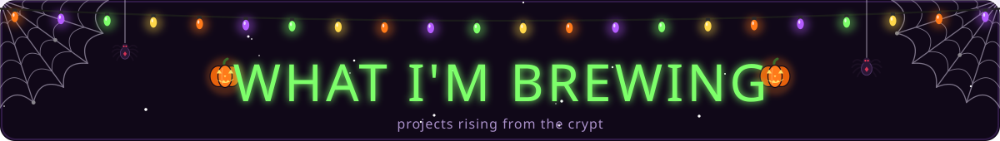

  <a href="https://yoursite.com"></a>
  
  
  

<!-- ───────────────────────── SKILLS ───────────────────────── -->

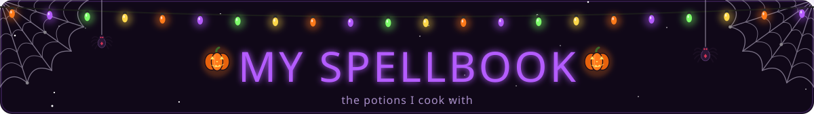

  

  

<!-- ───────────────────────── COMIC ───────────────────────── -->

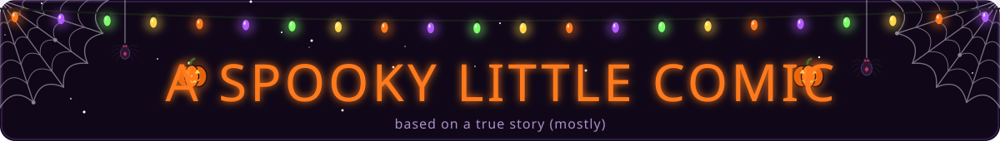

  

<!-- ───────────────────────── STATS ───────────────────────── -->

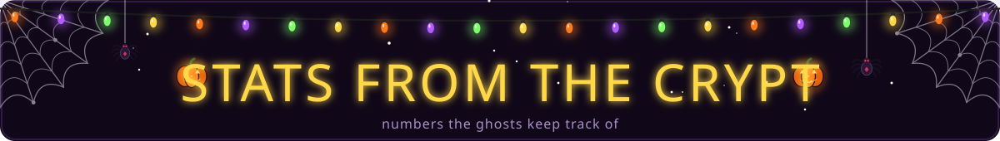

  

  

🕯️ <b>Psst… open for a spooky dev joke</b>

 
<blockquote>
  <b>Why did the developer go broke on Halloween?</b> 
  He used up all his <b>cache</b>. 💀
</blockquote>

  

🎃 Theme by <a href="https://github.com/aniketsingh1023/halloween-github-profile">@aniketsingh1023</a>

